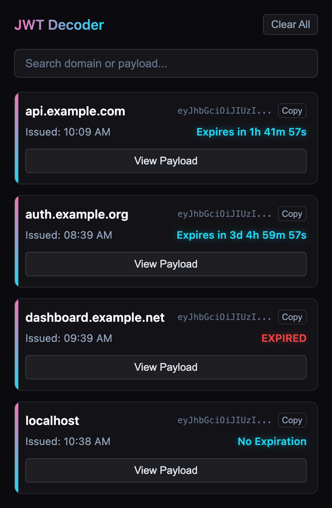
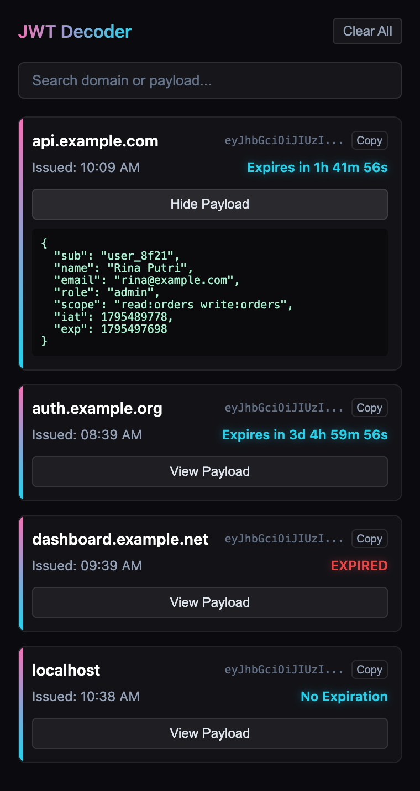
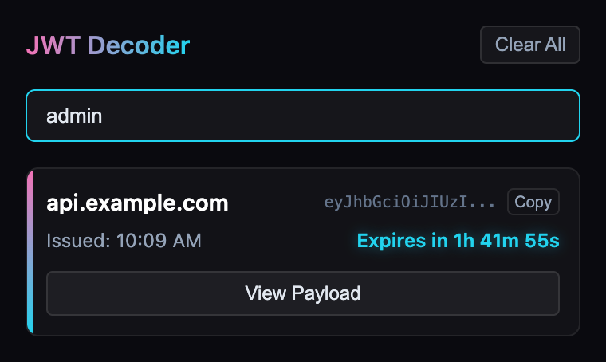
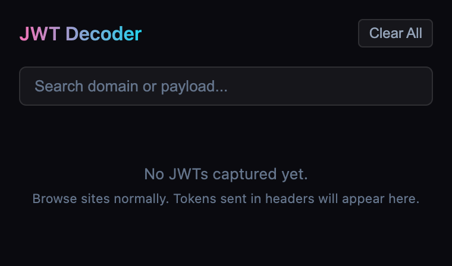
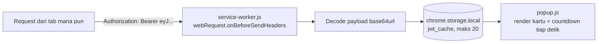

# Zero-Click JWT Decoder


Extension Chrome yang otomatis menangkap JWT dari header `Authorization: Bearer` di setiap request yang dikirim browser, men-decode payload-nya, dan menampilkan hitung mundur sampai token expired.

Nggak perlu buka DevTools, cari request di tab Network, salin header, lalu tempel ke jwt.io. Cukup browsing seperti biasa, lalu klik ikon extension.

<p align="center">
  
</p>

## Daftar isi

- [Fitur](#fitur)
- [Screenshot](#screenshot)
- [Instalasi](#instalasi)
- [Cara pakai](#cara-pakai)
- [Tes cepat](#tes-cepat)
- [Cara kerja](#cara-kerja)
- [Permission yang dipakai](#permission-yang-dipakai)
- [Privasi dan keamanan](#privasi-dan-keamanan)
- [Batasan](#batasan)
- [Struktur project](#struktur-project)
- [Development](#development)
- [Troubleshooting](#troubleshooting)
- [Kontribusi](#kontribusi)
- [Lisensi](#lisensi)

## Fitur

- **Tangkap otomatis.** Setiap request dengan header `Authorization: Bearer eyJ...` dari tab mana pun langsung dicatat, lengkap dengan domain tujuannya.
- **Decode payload.** Isi payload ditampilkan sebagai JSON yang rapi (klik **View Payload**).
- **Hitung mundur expiration.** Klaim `exp` diubah jadi countdown yang update tiap detik, misalnya `Expires in 1h 41m 57s`. Token yang lewat masa berlaku ditandai merah **EXPIRED**, token tanpa `exp` ditandai **No Expiration**.
- **Waktu terbit.** Klaim `iat` ditampilkan sebagai jam terbit token.
- **Copy token utuh.** Tombol **Copy** menyalin token lengkap ke clipboard, siap dipakai di Postman, curl, atau Insomnia.
- **Pencarian.** Filter berdasarkan domain atau isi payload apa pun (email, role, `sub`, scope, dan lainnya).
- **Riwayat 20 token terakhir.** Token terbaru di paling atas, duplikat diabaikan.
- **Clear All.** Hapus semua token yang tersimpan dengan sekali klik.
- **Tanpa dependency dan tanpa build step.** Murni HTML, CSS, dan JavaScript.

## Screenshot

| Lihat payload | Pencarian | Belum ada token |
| :---: | :---: | :---: |
|  |  |  |

> Semua screenshot memakai data contoh. Domain `example.com`, `example.org`, dan `example.net` adalah domain khusus dokumentasi, dan tokennya dibuat khusus untuk demo.

## Instalasi

Extension ini belum ada di Chrome Web Store, jadi dipasang lewat mode **Load unpacked**.

**Kebutuhan:** Google Chrome 88 ke atas, atau browser berbasis Chromium lain (Microsoft Edge, Brave, Opera, Vivaldi).

1. **Unduh source code.**

   ```bash
   git clone https://github.com/izeah/jwt-decoder-app.git
   ```

   Atau klik **Code → Download ZIP** di GitHub, lalu ekstrak.

2. **Buka halaman extension** dengan mengetik `chrome://extensions` di address bar.
3. **Aktifkan Developer mode** lewat toggle di pojok kanan atas.
4. **Klik Load unpacked**, lalu pilih folder `jwt-decoder-app` (folder yang berisi `manifest.json`).
5. **Pin ke toolbar** supaya gampang diakses: klik ikon puzzle di toolbar, lalu klik ikon pin di samping **Zero-Click JWT Decoder**.

Di browser lain langkahnya sama, cuma alamatnya berbeda:

| Browser | Alamat halaman extension |
| --- | --- |
| Microsoft Edge | `edge://extensions` (Developer mode ada di sidebar kiri) |
| Brave | `brave://extensions` |
| Opera | `opera://extensions` |
| Vivaldi | `vivaldi://extensions` |

**Update ke versi terbaru:** jalankan `git pull` di folder project, lalu klik tombol reload (ikon panah melingkar) di kartu extension pada `chrome://extensions`.

**Uninstall:** klik **Remove** di kartu extension. Semua token yang tersimpan ikut terhapus.

## Cara pakai

1. Buka aplikasi web yang memakai JWT untuk autentikasi, lalu pakai seperti biasa (login, buka halaman, panggil API).
2. Klik ikon extension di toolbar. Token yang tertangkap akan muncul sebagai kartu, terbaru di atas.
3. Setiap kartu berisi:
   - **Domain** tujuan request yang membawa token.
   - **Potongan token** (15 karakter pertama) dan tombol **Copy** untuk menyalin token lengkap.
   - **Issued**: jam token diterbitkan, dari klaim `iat`.
   - **Countdown**: sisa waktu sampai expired, dari klaim `exp`.
   - **View Payload**: buka atau tutup isi payload dalam format JSON.
4. Ketik di kolom **Search** untuk memfilter berdasarkan domain atau isi payload.
5. Klik **Clear All** untuk menghapus semua token.

Popup tetap ter-update otomatis: kalau ada token baru tertangkap saat popup terbuka, daftarnya langsung bertambah.

## Tes cepat

Mau cek extension sudah jalan tanpa harus login ke aplikasi sungguhan? Buka tab apa saja (misalnya `https://example.com`), buka DevTools Console (`F12` atau `Cmd+Option+J` di macOS), lalu jalankan:

```js
const b64 = (o) => btoa(JSON.stringify(o)).replace(/=+$/, '').replace(/\+/g, '-').replace(/\//g, '_');
const now = Math.floor(Date.now() / 1000);
const token = [
  b64({ alg: 'HS256', typ: 'JWT' }),
  b64({ sub: 'demo', role: 'tester', iat: now, exp: now + 3600 }),
  'signature',
].join('.');
fetch('/', { headers: { Authorization: `Bearer ${token}` } });
```

Snippet ini mengirim request ke domain yang sama dengan header `Authorization` berisi JWT dummy yang berlaku satu jam. Buka popup extension, dan token dari domain tersebut akan muncul dengan countdown sekitar `Expires in 59m ...`.

## Cara kerja



1. **Service worker** (`background/service-worker.js`) mendaftarkan listener `chrome.webRequest.onBeforeSendHeaders` untuk semua URL. Opsi `extraHeaders` dipakai supaya header `Authorization` bisa dibaca.
2. Kalau ada header `Authorization` yang nilainya diawali `Bearer ey` (semua JWT diawali `eyJ` karena header-nya berupa JSON yang di-encode base64url), token diambil dan dipecah jadi tiga bagian.
3. Bagian kedua (payload) di-decode dari base64url ke JSON. Token yang payload-nya gagal di-decode atau bukan tiga bagian akan dilewati.
4. Token disimpan di `chrome.storage.local` dengan key `jwt_cache`:

   ```js
   {
     domain: 'api.example.com',
     token: 'eyJhbGciOi...',        // token lengkap
     shortToken: 'eyJhbGciOiJIUzI...',
     fullPayload: { sub: '...', exp: 1795497698, ... },
     iat: 1795489778,
     exp: 1795497698,
     capturedAt: 1795489800000      // milidetik
   }
   ```

   Token baru masuk di urutan paling depan, duplikat diabaikan, dan daftar dipotong jadi maksimal 20 item.
5. **Popup** (`popup/popup.js`) membaca `jwt_cache`, merender kartu, menjalankan countdown setiap detik, dan mendengarkan `chrome.storage.onChanged` supaya daftar ter-update saat ada token baru.

## Permission yang dipakai

| Permission | Untuk apa |
| --- | --- |
| `webRequest` | Membaca header request keluar untuk mencari `Authorization: Bearer`. Extension tidak mengubah atau memblokir request apa pun. |
| `storage` | Menyimpan daftar token di `chrome.storage.local`. |
| `<all_urls>` (host permission) | Supaya header dari semua domain bisa dibaca. Tanpa ini, extension hanya bisa melihat domain tertentu. |

## Privasi dan keamanan

- **Semua data tetap di browser kamu.** Token hanya disimpan di `chrome.storage.local`. Extension ini tidak mengirim data ke server mana pun dan tidak melakukan network request sendiri.
- **JWT adalah kredensial.** Siapa pun yang memegang token bisa memakai akses kamu sampai token itu expired. Token disimpan tanpa enkripsi di profil browser, jadi:
  - jangan bagikan screenshot popup atau payload yang berisi token asli,
  - klik **Clear All** setelah selesai debugging,
  - nonaktifkan extension saat tidak dipakai, karena extension ini membaca header di semua situs.
- **Signature tidak diverifikasi.** Extension ini hanya men-decode payload. Payload yang tampil belum tentu valid atau dipercaya oleh server.
- Pakai untuk debugging aplikasi milikmu sendiri atau sistem yang memang kamu punya izin untuk mengujinya.

## Batasan

- Hanya menangkap token di header `Authorization: Bearer`. Token yang dikirim lewat cookie, body request, query string, atau header custom (misalnya `X-Access-Token`) tidak tertangkap.
- Hanya mendukung JWS biasa (tiga bagian dengan payload JSON). JWE yang terenkripsi (lima bagian) dilewati.
- Header JWT (`alg`, `kid`, dan lainnya) tidak ditampilkan, hanya payload.
- **Issued** hanya menampilkan jam dan menit, tanpa tanggal.
- Token yang sudah expired tidak dihapus otomatis. Token akan tergeser oleh token baru setelah daftar mencapai 20, atau hilang lewat **Clear All**.
- Request yang terjadi sebelum extension dipasang atau di-reload tidak tertangkap.

## Struktur project

```
jwt-decoder-app/
├── manifest.json             # Konfigurasi extension (Manifest V3)
├── background/
│   └── service-worker.js     # Menangkap header Authorization, decode, simpan ke storage
├── popup/
│   ├── popup.html            # Markup popup
│   ├── popup.css             # Styling (tema gelap, lebar 380px)
│   └── popup.js              # Render daftar, countdown, search, copy, clear
├── icons/                    # Ikon 16, 48, 128 px
├── LICENSE                   # MIT
└── docs/
    └── screenshots/          # Gambar untuk README
```

## Development

Tidak ada build step dan tidak ada `npm install`. Edit file, lalu muat ulang:

- **Perubahan di `service-worker.js` atau `manifest.json`:** klik tombol reload di kartu extension pada `chrome://extensions`.
- **Perubahan di `popup/`:** cukup tutup lalu buka lagi popup-nya.

Tempat debugging:

- **Service worker:** di `chrome://extensions`, klik link **service worker** pada kartu extension untuk membuka DevTools-nya.
- **Popup:** buka popup, klik kanan di dalamnya, lalu pilih **Inspect**.
- **Isi cache:** dari DevTools service worker atau popup, jalankan:

  ```js
  await chrome.storage.local.get('jwt_cache');
  ```

## Troubleshooting

**Tokennya nggak muncul.**
Buka DevTools → tab Network di situs tersebut, lalu cek apakah request-nya benar-benar membawa header `Authorization: Bearer eyJ...`. Banyak aplikasi menyimpan token di cookie `httpOnly`, dan token seperti itu tidak akan tertangkap (lihat [Batasan](#batasan)).

**Baru install atau reload extension, tapi daftarnya kosong.**
Request yang terjadi sebelumnya tidak ikut tertangkap. Refresh halaman aplikasinya, atau jalankan [Tes cepat](#tes-cepat).

**Service worker berstatus "inactive" di `chrome://extensions`.**
Ini normal di Manifest V3. Chrome mematikan service worker saat idle dan menyalakannya lagi otomatis saat ada request.

**Muncul error "Manifest file is missing or unreadable" saat Load unpacked.**
Pastikan yang dipilih adalah folder root project yang berisi `manifest.json`, bukan file ZIP atau subfolder seperti `popup/`.

## Kontribusi

Issue dan pull request terbuka untuk siapa saja.

1. Fork repo ini.
2. Buat branch baru: `git checkout -b fitur-baru`.
3. Commit perubahan, lalu push ke fork kamu.
4. Buka pull request dan jelaskan perubahan serta cara mengetesnya.

Sebelum membuka PR, coba muat extension lewat **Load unpacked** dan pastikan [Tes cepat](#tes-cepat) masih berjalan.

## Lisensi

Dirilis di bawah [MIT License](LICENSE).
